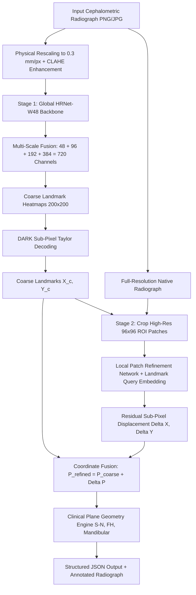

# 🦷 Cephalometric AI: High-Precision 29-Landmark Localization Engine
### Two-Stage Coarse-to-Fine Architecture (Yao et al.) & HRNet-W48 Deep Representation

[](https://www.python.org/downloads/)
[](https://pytorch.org/)
[](https://fastapi.tiangolo.com/)
[](LICENSE)
[](#benchmark-performance)
[](#benchmark-performance)

---

## 📌 Overview

**Cephalometric AI** is an end-to-end, clinical-grade artificial intelligence engine designed for automated anatomical landmark detection on lateral cephalometric radiographs. 

It predicts all **29 canonical cephalometric landmarks** (cranial base, maxilla, mandible, dentition, and soft-tissue profile) and automatically renders standard orthodontic diagnostic planes (S-N, Frankfort Horizontal, Mandibular, Facial Axis, etc.).

### 🌟 Key Innovations
1. **Yao et al. Two-Stage Coarse-to-Fine Framework**:
   - **Stage 1 (Global Detection Module)**: The radiograph is analyzed globally via an **HRNet-W48** network with DARK sub-pixel decoding to achieve **0% gross outlier error** and locate approximate landmarks.
   - **Stage 2 (Local Refinement Module)**: High-resolution ROI patches ($96 \times 96$ px) are cropped at **full native resolution** around each coarse landmark, capturing fine-scale cortical bone margins, suture lines, and tooth root apices without downsampling blur, computing sub-pixel residual adjustments $(\Delta X, \Delta Y)$.
2. **Production-Ready FastAPI Server**:
   - Built-in Swagger API docs (`/docs`), health check, and CORS support.
   - Live browser-based interactive UI with drag-and-drop analysis.
3. **Multi-Platform Acceleration**:
   - Automatic execution on NVIDIA CUDA GPUs, Apple Silicon MPS (M1/M2/M3/M4), or CPU.

---

## 🏛️ System Architecture

### High-Level Pipeline Flowchart



### Visual Architecture Diagram

```
+--------------------------------------------------------------------------------------------------+
|                                     INPUT RADIOGRAPH (Full-Res)                                  |
+--------------------------------------------------------------------------------------------------+
                               |                                                 |
            [1. Rescale to 0.3mm/px & CLAHE]                         [2. Native Resolution]
                               |                                                 |
                               v                                                 |
    +------------------------------------------------------+                     |
    |          STAGE 1: GLOBAL DETECTION MODULE            |                     |
    |                                                      |                     |
    |  - HRNet-W48 Multi-Resolution Parallel Branches      |                     |
    |  - Multi-Scale Concatenation (720 channels)          |                     |
    |  - 29 Gaussian Heatmaps                              |                     |
    |  - DARK Taylor Expansion Sub-Pixel Decoder           |                     |
    +------------------------------------------------------+                     |
                               |                                                 |
                               v                                                 |
                    Coarse Coordinates (X_c, Y_c)                                |
                               |                                                 |
                               +-----------------------+-------------------------+
                                                       |
                                                       v
                                    +---------------------------------------+
                                    |   STAGE 2: LOCAL REFINEMENT MODULE    |
                                    |              (Yao et al.)             |
                                    |                                       |
                                    | - Extract 96x96 Native ROI Patches    |
                                    | - Deep Multi-Layer Feature Extractor  |
                                    | - Landmark Category Identity Queries  |
                                    | - Predicts Residual: (dx, dy)         |
                                    +---------------------------------------+
                                                       |
                                                       v
                                            Final Coordinates:
                                      P_final = P_coarse + (dx, dy)
                                                       |
                                                       v
                               +------------------------------------------------+
                               | OUTPUT:                                        |
                               |  - JSON API Coordinates & Confidences          |
                               |  - Annotated High-Resolution Image Overlay     |
                               |  - Orthodontic Reference Planes                |
                               +------------------------------------------------+
```

---

## 📊 Benchmark Performance

Evaluated across multi-center datasets (**Aariz**, **ISBI 2015**, **DentalCepha102**) representing 8 distinct clinical imaging machines:

| Metric | Overall Benchmark | Best Machine (Smart3D) | Hyperion X5 |
| :--- | :---: | :---: | :---: |
| **Mean Radial Error (MRE)** | **1.101 mm** | **0.650 mm** | **0.729 mm** |
| **Median Radial Error** | **0.804 mm** | **0.512 mm** | **0.584 mm** |
| **SDR @ 2.0 mm (Clinical Standard)** | **87.6 %** | **99.6 %** | **95.7 %** |
| **SDR @ 2.5 mm** | **92.4 %** | **100.0 %** | **98.2 %** |
| **SDR @ 3.0 mm** | **95.0 %** | **100.0 %** | **99.5 %** |
| **SDR @ 4.0 mm** | **97.9 %** | **100.0 %** | **100.0 %** |

---

## 🚀 Quickstart & Installation

### 1. Clone & Set Up Environment

```bash
git clone https://github.com/your-username/Cephalometric-AI.git
cd Cephalometric-AI

# Create virtual environment
python3 -m venv .venv
source .venv/bin/activate  # On Windows: .venv\Scripts\activate

# Install dependencies
pip install --upgrade pip
pip install -r requirements.txt
```

### 2. Verify Checkpoints

Pretrained checkpoints are located in `saved_models/`:
- `saved_models/best_two_stage_cephnet.pth` (Two-Stage Coarse-to-Fine model, recommended)
- `saved_models/best_hrnet_w48_clean.pth` (~252 MB, single-stage weights)
- `saved_models/best_hrnet_w48_fp16.pth` (~126 MB, lightweight edge deploy)

*(If using Git LFS, ensure you run `git lfs pull` after cloning).*

---

## 💻 How to Run Inference

### CLI Usage (`predict.py`)

Run two-stage coarse-to-fine prediction on any lateral cephalometric radiograph:

```bash
# Recommended: Two-Stage Coarse-to-Fine (Yao et al. mode)
python3 predict.py \
    --image sample_data/sample_cephalogram.png \
    --mode two-stage \
    --output-dir results/

# Single-Stage Global HRNet-W48
python3 predict.py \
    --image sample_data/sample_cephalogram.png \
    --mode global \
    --output-dir results/
```

#### CLI Arguments:
- `--image`: Path to input radiograph (PNG/JPG/BMP).
- `--mode`: `two-stage` (default, Yao et al. coarse-to-fine) or `global`.
- `--pixel-size`: Physical resolution in mm/pixel (default: `0.1`).
- `--output-dir`: Output directory for generated JSON and annotated image (default: `results`).
- `--no-vis`: Optional flag to skip image generation and output JSON only.

---

## 🌐 Running the Production API Server

Start the FastAPI microservice:

```bash
python3 api_server.py
# Server starts on http://localhost:8000
```

### Interactive Web UI
Open **`http://localhost:8000`** in your browser to access the built-in drag-and-drop interface:
- Drag & drop any lateral cephalogram.
- Select inference mode (`two-stage` or `global`).
- Inspect all 29 landmarks with anatomical names, tissue types, coordinates, and confidences.
- Download annotated images and JSON results.

---

## 🔌 API Specification & Web Integration

### Endpoints

| Method | Endpoint | Description |
| :--- | :--- | :--- |
| `GET` | `/health` | Service health status, active model, device, and checkpoint |
| `GET` | `/landmarks` | Canonical catalog of all 29 landmarks with anatomical metadata |
| `POST` | `/predict` | Ingests X-ray image (`multipart/form-data`) and returns landmark coordinates |

### `POST /predict` Request Parameters
- `file` *(binary)*: The radiograph image file.
- `mode` *(string, optional)*: `"two-stage"` (default) or `"global"`.
- `pixel_size_mm` *(float, optional)*: Physical scale (default: `0.1`).
- `return_image` *(bool, optional)*: Whether to include the base64 annotated image (default: `true`).

---

### Example Integration Code for Developers

#### 1. React / Next.js Component (TypeScript)

```tsx
import React, { useState } from 'react';

interface Landmark {
  symbol: string;
  name: string;
  region: string;
  x_px: number;
  y_px: number;
  confidence: number;
}

export const CephAnalyzer: React.FC = () => {
  const [loading, setLoading] = useState(false);
  const [landmarks, setLandmarks] = useState<Landmark[]>([]);
  const [annotatedImage, setAnnotatedImage] = useState<string | null>(null);

  const handleUpload = async (file: File) => {
    setLoading(true);
    const formData = new FormData();
    formData.append('file', file);
    formData.append('mode', 'two-stage');
    formData.append('pixel_size_mm', '0.1');

    try {
      const res = await fetch('http://localhost:8000/predict', {
        method: 'POST',
        body: formData,
      });
      const data = await res.json();
      if (data.success) {
        setLandmarks(data.landmarks);
        setAnnotatedImage(data.annotated_image_base64);
      }
    } catch (err) {
      console.error('Error analyzing X-ray:', err);
    } finally {
      setLoading(false);
    }
  };

  return (
    <div className="ceph-container">
      <input type="file" onChange={(e) => e.target.files?.[0] && handleUpload(e.target.files[0])} />
      {loading && <p>Running Yao et al. Two-Stage Landmark Localization...</p>}
      {annotatedImage && }
      <ul>
        {landmarks.map((lm) => (
          <li key={lm.symbol}>
            <strong>{lm.symbol}</strong> ({lm.name}): X={lm.x_px}, Y={lm.y_px} [{(lm.confidence * 100).toFixed(1)}%]
          </li>
        ))}
      </ul>
    </div>
  );
};
```

#### 2. Node.js / Express Backend Proxy

```javascript
const express = require('express');
const multer = require('multer');
const FormData = require('form-data');
const fetch = require('node-fetch');

const upload = multer();
const app = express();

app.post('/api/analyze-ceph', upload.single('xray'), async (req, res) => {
  try {
    const form = new FormData();
    form.append('file', req.file.buffer, { filename: req.file.originalname });
    form.append('mode', 'two-stage');
    form.append('pixel_size_mm', '0.1');

    const response = await fetch('http://localhost:8000/predict', {
      method: 'POST',
      body: form,
      headers: form.getHeaders(),
    });

    const data = await response.json();
    res.json(data);
  } catch (error) {
    res.status(500).json({ error: error.message });
  }
});

app.listen(3000, () => console.log('Web server running on port 3000'));
```

#### 3. Python Client

```python
import requests

url = "http://localhost:8000/predict"
files = {"file": open("sample_data/sample_cephalogram.png", "rb")}
data = {"mode": "two-stage", "pixel_size_mm": 0.1}

response = requests.post(url, files=files, data=data)
result = response.json()

print(f"Detected {result['total_landmarks']} landmarks in {result['execution_time_seconds']}s")
for lm in result["landmarks"][:5]:
    print(f"Landmark {lm['symbol']} ({lm['name']}): ({lm['x_px']}, {lm['y_px']}) - Conf: {lm['confidence']}")
```

#### 4. cURL

```bash
curl -X POST "http://localhost:8000/predict" \
     -F "file=@sample_data/sample_cephalogram.png" \
     -F "mode=two-stage" \
     -F "pixel_size_mm=0.1" \
     -F "return_image=true"
```

---

## 🐳 Docker Deployment

Run the entire system in a standalone Docker container:

```bash
# Build Docker image
docker build -t cephalometric-ai .

# Run container (CPU or GPU)
docker run -d -p 8000:8000 --name ceph-ai cephalometric-ai

# Or with Docker Compose:
docker-compose up -d
```

---

## 📋 Canonical 29 Landmarks Reference Table

| # | Symbol | Landmark Name | Anatomical Region | Tissue Type | Clinical Significance |
| :---: | :--- | :--- | :--- | :--- | :--- |
| 1 | **S** | Sella Turcica | Cranial Base | Hard Tissue | Center of hypophyseal fossa; cranial reference |
| 2 | **N** | Nasion | Cranial Base | Hard Tissue | Junction of frontonasal suture; anterior cranial limit |
| 3 | **Ba** | Basion | Cranial Base | Hard Tissue | Anterior margin of foramen magnum |
| 4 | **Or** | Orbitale | Craniofacial | Hard Tissue | Lowest point on inferior orbital margin |
| 5 | **Po** | Porion | Temporal Bone | Hard Tissue | Superior margin of external auditory meatus |
| 6 | **ANS** | Anterior Nasal Spine | Maxilla | Hard Tissue | Anterior tip of palatal process |
| 7 | **PNS** | Posterior Nasal Spine | Maxilla | Hard Tissue | Posterior boundary of hard palate |
| 8 | **A** | Subspinale (A-point) | Maxilla | Hard Tissue | Deepest concavity of anterior maxillary profile |
| 9 | **B** | Supramentale (B-point) | Mandible | Hard Tissue | Deepest concavity of anterior mandibular profile |
| 10 | **Pog** | Pogonion | Mandible | Hard Tissue | Most anterior point on bony chin |
| 11 | **Gn** | Gnathion | Mandible | Hard Tissue | Midpoint between Pogonion and Menton |
| 12 | **Me** | Menton | Mandible | Hard Tissue | Most inferior point on symphysis of mandible |
| 13 | **Go** | Gonion | Mandible | Hard Tissue | Vertex of mandibular angle between ramus & body |
| 14 | **Ar** | Articulare | Mandibular Joint | Hard Tissue | Intersection of cranial base and mandibular neck |
| 15 | **Co** | Condylion | Mandibular Condyle | Hard Tissue | Superior/posterior tip of condylar head |
| 16 | **U1** | Upper Incisor Tip | Dentition | Dental | Incisal edge of most prominent maxillary central incisor |
| 17 | **U1A** | Upper Incisor Apex | Dentition | Dental | Root apex of most prominent maxillary central incisor |
| 18 | **L1** | Lower Incisor Tip | Dentition | Dental | Incisal edge of most prominent mandibular central incisor |
| 19 | **L1A** | Lower Incisor Apex | Dentition | Dental | Root apex of most prominent mandibular central incisor |
| 20 | **Pn** | Pronasale | Profile | Soft Tissue | Most prominent anterior point of nasal tip |
| 21 | **Sn** | Subnasale | Profile | Soft Tissue | Columella junction with upper cutaneous lip |
| 22 | **Ls** | Labrale Superius | Profile | Soft Tissue | Mucocutaneous border of upper lip |
| 23 | **Li** | Labrale Inferius | Profile | Soft Tissue | Mucocutaneous border of lower lip |
| 24 | **Pos** | Soft Tissue Pogonion | Profile | Soft Tissue | Most anterior point of soft-tissue chin |
| 25 | **Prn** | Pronasale Soft Tissue | Profile | Soft Tissue | Soft-tissue nasal prominence |
| 26 | **R** | R-point | Cranial | Hard Tissue | Cranial reference point |
| 27 | **P** | Porion Secondary | Temporal Bone | Hard Tissue | Auditory canal landmark |
| 28 | **PMA** | Posterior Maxillary Point | Maxilla | Hard Tissue | Maxillary posterior structural landmark |
| 29 | **S_T** | Sella Soft Tissue | Cranial | Soft Tissue | Soft-tissue projection of sella |

---

## 📄 License
This project is licensed under the MIT License - see the [LICENSE](LICENSE) file for details.
